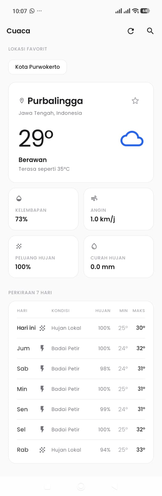
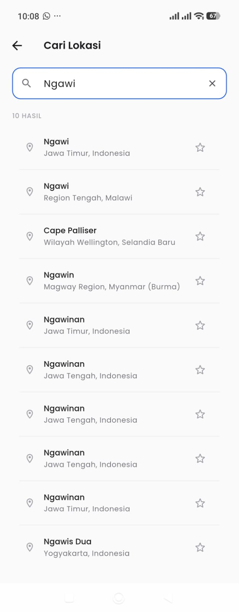
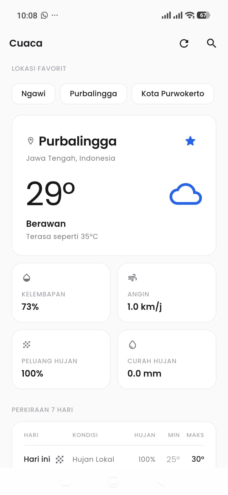
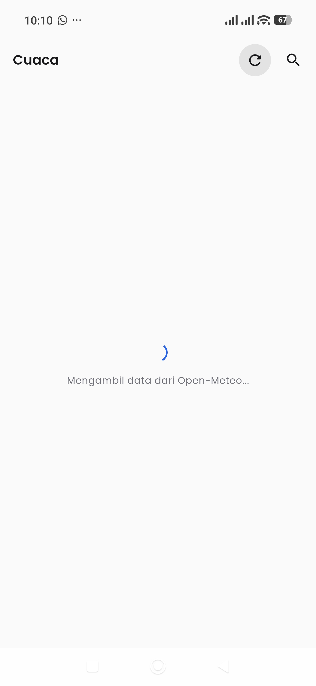
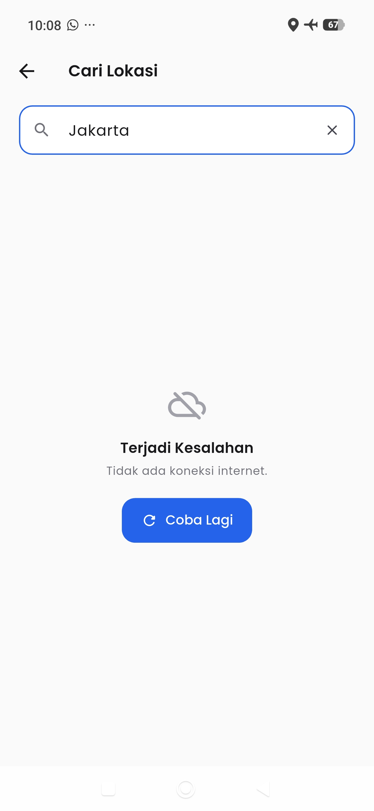

# Weather App

Aplikasi cuaca Flutter yang menampilkan cuaca terkini dan prakiraan 7 hari menggunakan
[Open-Meteo API](https://open-meteo.com/), dengan favorit, riwayat pencarian, dan lokasi
terakhir yang disimpan secara lokal memakai Hive.

## Screenshot

| Home | Search | Favorit | Loading | Error |
|---|---|---|---|---|
|  |  |  |  |  |

## Struktur Aplikasi

```text
lib/
├── main.dart                         # Inisialisasi Hive, adapter, repository, runApp
├── app.dart                          # MaterialApp, tema, provider repository & cubit
│
├── core/                             
│   ├── constants/
│   │   ├── api_constants.dart        # Base URL, field API, timeout, jumlah hari
│   │   └── hive_boxes.dart           # Nama box Hive & batas riwayat
│   ├── errors/
│   │   └── app_failure.dart          # Exception domain dengan pesan siap tampil
│   ├── theme/
│   │   └── app_theme.dart            # AppColors, AppTheme.light(), AppInput
│   └── utils/
│       ├── formatters.dart           # Format suhu, persen, angin, mm, hari
│       └── weather_code_mapper.dart  # Kode cuaca WMO → label Indonesia + ikon
│
├── data/                             
│   ├── models/
│   │   ├── location_model.dart       # Model lokasi + Hive TypeAdapter
│   │   └── weather_model.dart        # CurrentWeather, DailyForecast, WeatherModel
│   ├── repositories/
│   │   ├── location_repository.dart  # Pencarian + favorit + riwayat + lokasi terakhir
│   │   └── weather_repository.dart   # Ambil cuaca + translasi error jaringan
│   └── services/
│       ├── geocoding_service.dart    # HTTP ke Geocoding API
│       └── weather_service.dart      # HTTP ke Forecast API
│
├── viewmodel/                        
│   ├── weather/
│   │   ├── weather_cubit.dart        # start, load, refresh
│   │   └── weather_state.dart        # initial / loading / success / error
│   ├── search/
│   │   ├── search_cubit.dart         # Debounce, pencarian, riwayat
│   │   └── search_state.dart         # initial / loading / success / empty / error
│   └── favorites/
│       ├── favorites_cubit.dart      # load, toggle, remove
│       └── favorites_state.dart      # Daftar favorit + contains(id)
│
└── view/                             
    ├── screens/
    │   ├── weather_screen.dart       # Beranda cuaca
    │   └── search_screen.dart        # Pencarian kota
    └── widgets/
        ├── common_widgets.dart       # AppCard, SectionTitle, Loading/Empty/ErrorView
        ├── current_weather_card.dart # Kartu cuaca terkini
        ├── weather_detail_grid.dart  # Grid detail (2/4 kolom responsif)
        ├── daily_forecast_list.dart  # Prakiraan 7 hari
        └── location_tile.dart        # Item kota + tombol favorit
```

**Penjelasan lapisan:**

- **`core/`** — kode dasar yang dipakai semua lapisan: konstanta API dan Hive, tema/warna,
  formatter tampilan, mapping kode cuaca, serta `AppFailure` untuk pesan error.
- **`data/`** — berisi model, service HTTP ke Open-Meteo, dan repository. Repository menjadi
  satu-satunya pintu akses data: mengambil data jaringan sekaligus membaca/menulis Hive
  untuk favorit, riwayat, dan lokasi terakhir.
- **`viewmodel/`** — Cubit dan state per fitur (`weather`, `search`, `favorites`). Mengatur
  status UI (loading, success, empty, error) dan memanggil repository.
- **`view/`** — layar dan widget. Hanya menampilkan state dari cubit dan meneruskan aksi
  pengguna (pilih kota, favorit, refresh, cari) kembali ke cubit.
- **`main.dart` & `app.dart`** — titik masuk aplikasi: menyiapkan Hive, dependency
  injection, dan `MaterialApp`.

## Implementasi API
- Geocoding: GET /v1/search?name=...&language=id
- Forecast: GET /v1/forecast?latitude=..&longitude=..&current=..&daily=..&timezone=auto
- JSON diparsing di data/models, error dipetakan di repository.
- Catatan: peluang hujan diambil dari daily.precipitation_probability_max[0].

## Penerapan MVVM
- Model: data/ (models, services, repositories)
- ViewModel: viewmodel/ (Cubit dari flutter_bloc) 
- View: view/ (screens, widgets) 
Alur: View -> Cubit -> Repository -> Service -> Model -> emit(state) -> BlocBuilder

## Local Storage
Hive, TypeAdapter manual (typeId 0), box: favorites, search_history, last_location.